<div align="center">

<picture>
  <source media="(prefers-color-scheme: dark)" srcset="docs/readme/hero-dark.svg">
  
</picture>

[](https://cal01-review.onrender.com/)
[](https://github.com/posco-3bungi-pdm/pdm-project)
[](https://github.com/posco-3bungi-pdm/cal01-monitor)

</div>

연속 소둔로(CAL01) 이상 후보를 팀이 함께 보고 판단을 남기는 검토 사이트임. 3σ 통계 후보와 모델이 고른 후보를 LOT 그래프 위에 띄움. 팀원이 1·0·보류와 메모를 남기면 그 판단이 검토 표(`domain_decisions.csv`)가 되어 pdm-project의 다음 정답(v6, v7)으로 돌아감.


## 후보가 들어와 정답으로 돌아가는 길

<picture>
  <source media="(prefers-color-scheme: dark)" srcset="docs/readme/flow-dark.svg">
  
</picture>

## 화면

| 화면 | 하는 일 |
| --- | --- |
| 검토 | 왼쪽 1 : 오른쪽 9. LOT을 고르면 후보 목록이 나오고 후보를 고르면 그래프에 노란색 구간이 표시됨. 판단 메모는 왼쪽에서 나옴 |
| 그래프 도구 | 채널 고르기(TC, OP, CP, CLN-IN), Z-score ±3σ 기준선, 시간창 줄이기·늘리기, 앞뒤 더 보기, LOT 전체, 라벨 띠 v4·v5·v6, 정비 기록 줄, 1초 원본 확대, 구간 스냅샷 |
| 판단 | 1 · 0 · 보류, 모델 학습 포함 여부, 조업 상태, 판단 메모, 고정, 팀원 의견(댓글), 수정 이력 |
| 팀원 기록 | 팀원이 공유한 구간. 최신순·오래된순·제목순·작성자순, 격자형·패널형, 폴더 색 |
| LOT 나란히 비교 | 고른 LOT 수만큼 열이 생기고 세로 눈금은 같음. 센서를 바꿔 가며 봄 |
| 팀 알림 | 다른 팀원의 판단·댓글이 생기면 알림 |
| 검토 표 내보내기 | `/export/domain_decisions.csv`. 판단 1, 0만 분석 노트북 형식으로 받음 |

## 만든 방식

| 부분 | 쓴 것 |
| --- | --- |
| 서버 | Python Flask (`app.py` 한 파일, `db.py`) |
| DB | 내 PC는 `local.db` (SQLite), Render는 Postgres. 표는 `schema.sql` |
| 화면 | Jinja 템플릿 + 기본 JavaScript + Chart.js. 대리석 배경과 양각 아이콘 |
| 배포 | Render 무료 (15분 안 쓰면 잠들고 다시 열 때 약 1분) |
| 접속 | 팀 접속 코드. 코드는 해시로만 저장 (`make_hashes.py`) |

## 데이터

| 표 | 담는 것 |
| --- | --- |
| `lots`, `raw_chunks` | LOT 14개의 1분 기록과 1초 원본 조각 |
| `candidates` | 후보 하나 = LOT, 센서, 시작, 끝, 출처(3σ, 모델 후보), 판단, 판단자, 메모 |
| `labels` | 버전별 라벨 띠 (v4, v5, v6) |
| `work_records`, `history`, `comments`, `folders`, `snapshots` | 조업·정비 기록, 판단 수정 이력, 팀원 의견, 폴더, 구간 스냅샷 |
| `members` | 팀원 이름과 접속 코드 해시 |

## 스크립트

| 스크립트 | 하는 일 |
| --- | --- |
| `import_data.py` | 표를 비우고 LOT, 기록, 3σ 후보, 검토 표(VERSION 기준)를 다시 채움. Render DB에 돌리면 팀원 판단도 지워지므로 yes를 물어봄 |
| `import_extra.py` | 쓰고 있는 DB에 새 기록만 더함 |
| `import_raw.py` | 1초 원본을 `raw_chunks`에 넣음 (판단은 안 건드림) |
| `import_labels.py` | 버전별 라벨 띠 |
| `import_candidates.py` | pdm-project 12번 노트북이 뽑은 모델 후보 60개를 "모델 후보"로 올림. 어느 모델이 골랐는지는 사이트에 안 보임 |
| `export_candidates.py` | 모델 후보에 팀원이 남긴 판단을 검토 표 VERSION v7로 더함. 판단자가 "AI 제안"인 것은 넣지 않음 |
| `make_hashes.py` | 팀 접속 코드 해시 |

## 내 PC에서 실행

```bash
python -m venv .venv
.venv\Scripts\pip install -r requirements.txt
copy .env.example .env
.venv\Scripts\python import_data.py
.venv\Scripts\python app.py
```

- `http://127.0.0.1:5000` 으로 열기
- `.env`의 `TEAM_ACCESS_MEMBERS_JSON`은 `python make_hashes.py`로 만듦 (코드는 해시로만 저장)

## Render에 올리기 (처음 한 번)

1. Render에 GitHub로 가입, `posco-3bungi-pdm/cal01-review` 저장소 접근 허용
2. New → Blueprint → 이 저장소 선택 → `render.yaml`대로 웹 서비스와 Postgres가 만들어짐
3. `TEAM_ACCESS_MEMBERS_JSON` 값을 물어보면 `make_hashes.py` 결과를 붙여 넣음
4. Postgres 화면의 External Database URL을 복사해서 내 PC `.env`의 `DATABASE_URL=`에 넣고 `python import_data.py` 실행
5. 넣은 뒤 `.env`의 `DATABASE_URL=`은 다시 비움
6. (선택) Render → `cal01-review` → Environment에 `CONTACT_EMAIL`을 넣으면 푸터에 이메일 아이콘이 생김
7. 1초 원본 넣기: 4번처럼 `DATABASE_URL`을 넣고 `python import_raw.py` 실행. 안 넣으면 구간 확대가 1분 평균으로만 보임

## 주의

| 항목 | 내용 |
| --- | --- |
| `import_data.py` | 표를 비우고 다시 채움. Render DB에 실행하면 팀원이 사이트에 남긴 판단도 지워짐 (실행 전에 yes를 물어봄) |
| 무료 Postgres | 만든 날부터 30일 뒤 만료 (14일 유예). 그 전에 `검토 표 내보내기`로 받아 두기 |
| 판단자 이름 | 사이트에 남은 이름 그대로 검토 표에 들어감. "AI 제안"은 팀이 확인해 이름을 바꾼 것만 정답에 넣음 |
| 올리지 않는 것 | `.env`, `local.db`, `.venv` (`.gitignore`에 있음) |
